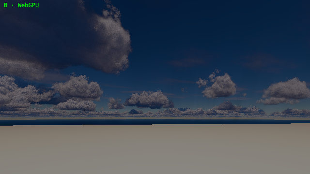
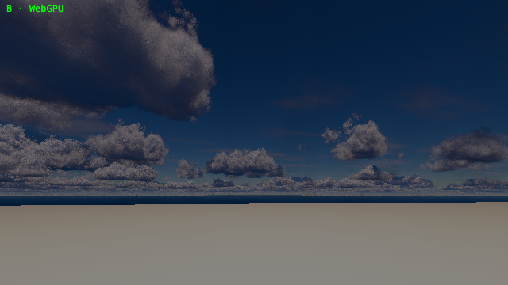
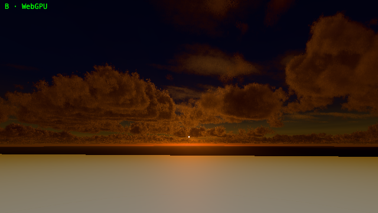
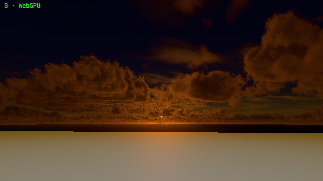

# Reversed-depth cloud-shadow regression

These are real Chrome/WebGPU captures, not reference renders or edited images.
The test configures the parity example's renderer with reversed depth off/on,
verifies the camera's actual projection flag and compares the resulting cloud
shadow fits and pixels. Ordinary-depth frames before and after the fix are
pixel-identical at both sun elevations.

## Reproduction

The [hardware test](../../reversedDepth.spec.ts) uses the existing synthetic
scene and unchanged cloud presets: camera 500 m above the anchor, near/far
1/60,000 m, 60-degree field of view, three 256-square shadow cascades and
split lambda 0.6. Shadow temporal accumulation and Bayer upscale are disabled
for this comparison; cloud TAA warms for 64 frames at fixed time. Midday looks
north, opposite the south-facing sun at elevation 60 degrees. Sunset looks
toward the same sun at elevation 2 degrees. These are test settings, not new
library defaults.

```sh
pnpm build
PARITY_GPU=hardware pnpm e2e --grep 'reversed depth preserves'
```

The committed `before` captures ran before the two production fixes. Both tests
failed the cascade-width assertion, with no application or console errors.
`after` captures pass. Each JSON records the actual camera/renderer flags,
resolved library root, built-module SHA-256, cascade intervals, texel sizes,
cloud coverage/radiance and pixel comparison. Only the missing UI favicon is
answered with HTTP 204; asset, JavaScript, TSL and GPU errors are not filtered.

| Measurement | Ordinary depth | Reversed before | Reversed after |
| --- | ---: | ---: | ---: |
| Near cascade texel | 74.877 m | 560.032 m | 74.877 m |
| Middle cascade texel | 160.333 m | 468.862 m | 160.333 m |
| Far cascade texel | 610.613 m | 259.988 m | 610.613 m |
| Midday mean absolute RGB difference, full scale | 0 | 1.0637% | 0.00994% |
| Sunset mean absolute RGB difference, full scale | 0 | 0.52170% | 0.01253% |

Cloud-pixel counts and mean cloud-layer radiance match the ordinary-depth
control after the fix. The small remaining full-frame difference is bounded by
the predeclared 0.2% mean / 1% changed-pixel limits, not exact whole-frame bit
equality. The ordinary-depth controls do have exact pixel equality across the
code change.

| Scene | Before, reversed | After, reversed |
| --- | --- | --- |
| Midday, anti-sun |  |  |
| Sunset |  |  |

Ordinary-depth controls: [midday before](before/midday-ordinary.png),
[midday after](after/midday-ordinary.png), [sunset before](before/sunset-ordinary.png),
[sunset after](after/sunset-ordinary.png).

## Depth-convention audit

Classification: unprojected physical positions must use the correct NDC
endpoints; perspective direction-only inverse projections can ignore homogeneous
depth; raw scene depth must use the renderer's decoder and clear value; linear
history and independently owned shadow projections are not camera depth buffers.
The mechanical production scan covered 14 modules matching unprojection, inverse
projection, raw-depth conversion, reprojection or depth-clear operations, followed
by the linear resolve readers below.

| Path under `src/` | Finding and evidence |
| --- | --- |
| `shadow/CascadedShadowMaps.ts` | Fixed: use physical near/far NDC 1/0 when `camera.reversedDepth`; otherwise retain WebGPU 0/1 and WebGL -1/1. Split intervals already use positive physical distances. Tests compare both clip conventions, every split mode, fade on/off and all six cascade matrices. |
| `march/sceneDepth.ts` and `pass/marchGraph.ts` | Fixed: the caller did not provide the optional reversed flag, so the clear test stayed ordinary. It now inherits `builder.renderer.reversedDepthBuffer` unless explicitly overridden. WGSL tests cover both inherited and explicit conventions; five physical depths round-trip through Three's actual projection matrices and the CPU twin. |
| `CameraUniforms.ts`, `march/cloudsFragment.ts`, `experimental/cloudEnvironment.ts` | Perspective ray construction uses inverse-projected homogeneous **XYZ**, without dividing by W. That direction is unchanged by the projection's depth row. A new camera-uniform regression verifies all 16 jitter phases, moved cameras and hit/miss reprojection XY. No change needed. |
| `integration.ts`, the fork build's `AerialPerspectiveNode` (cloud shadows enter through its `shadowNode`; it replaced the deleted interim subclass) | Raw depth conversion delegates to Takram's `depthToViewZ`, whose pinned Three.js perspective/orthographic helpers branch on the renderer's reversed flag. Surface position uses the supplied projection/inverse and physical view Z; sky detection already uses clear 0 when reversed. No second reversal should be applied. |
| `CloudsPassNode.ts`, `pass/shadowUniforms.ts` | Copies actual camera projection/view matrices and physical near/far distances. No extra raw-NDC endpoint assumption. |
| `shadow/fadedCascadeIndex.ts`, `shadow/shadowRadius.ts` | Cascade selection uses physical view depth; footprint projection uses XY/W. Atlas unprojection uses the matching atlas inverse, not the scene's depth convention. |
| `shadow/shadowResolve.ts`, `pass/shadowGraph.ts` | Atlas history uses the owned shadow matrices and linear distances. Its orthographic projection remains ordinary WebGL clip space regardless of scene-camera reversal. |
| `shadow/opticalDepthMarch.ts` | Its NDC near value -1 belongs to that independently created ordinary shadow projection, so changing it to the scene-camera near value would be wrong. |
| `march/shadowLengthMarch.ts` | Integrates world-space ray distances. Its scene limit comes through the corrected scene-depth path, not a second raw depth read. |
| `resolve/cloudsResolve.ts`, `resolve/shadowLengthResolve.ts`, `experimental/computeResolve.ts` | History depth is positive physical distance, scaled to attachment units, rather than hardware depth. Choosing the smallest stored distance remains correct with reversed camera depth. |

Pinned development runtime: Three.js **0.185.1**, declarations **0.185.0**.
`Camera.reversedDepth` is a getter in this version; unit tests override that getter
and call the real `updateProjectionMatrix`, rather than trying to assign a
read-only property. The renderer sets its backing flag in the hardware tests.
Older cameras without the property retain the ordinary convention.

Logarithmic depth remains delegated to the existing renderer-owned decoder;
its decode-once regression still passes. These results do not certify enabling
logarithmic and reversed depth simultaneously, orthographic cloud rendering,
custom projection matrices, every GPU/browser or a new full parity ladder.
`examples/basic` and the documented manual Usage code are unchanged.
